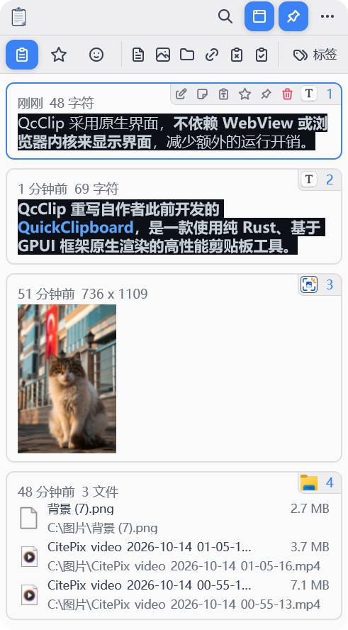
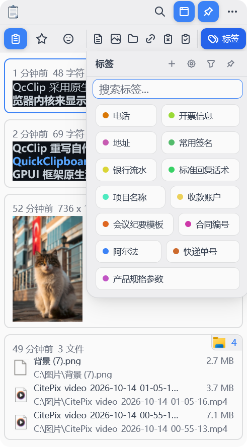
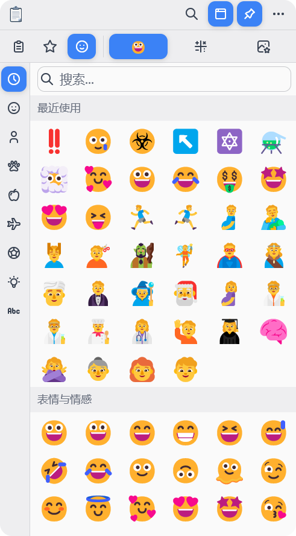
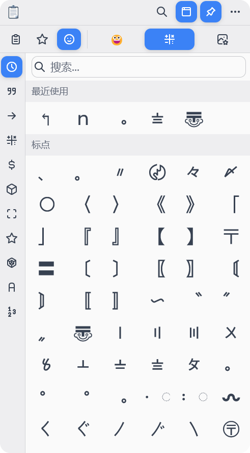
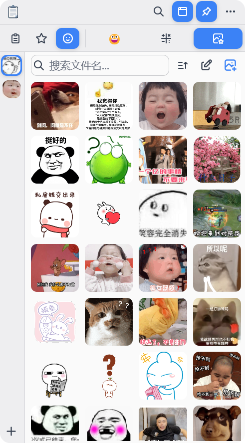
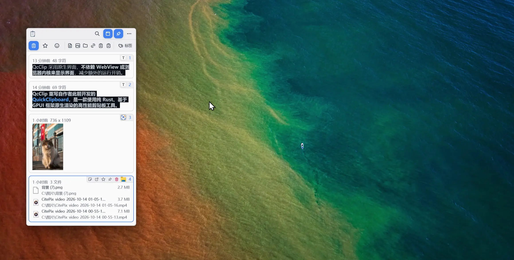
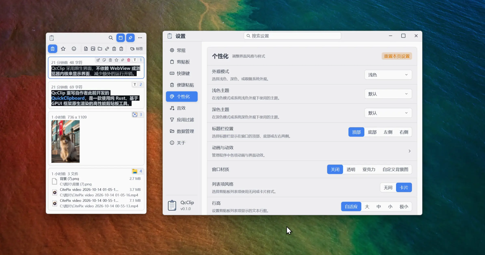
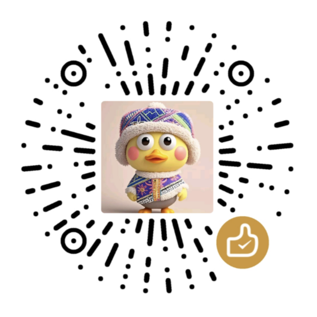

<p align="center">
  
</p>

<h1 align="center">QcClip</h1>

<p align="center">純 Rust · GPUI 原生繪製 · 高效能剪貼簿工具</p>

<p align="center">
  <a href="https://github.com/mosheng1/QcClip/stargazers">
    
  </a>
  <a href="https://github.com/mosheng1/QcClip/releases">
    
  </a>
  <a href="https://github.com/mosheng1/QcClip/releases">
    
  </a>
  <a href="https://github.com/mosheng1/QcClip">
    
  </a>
</p>

<p align="center">
  <a href="../README.md">简体中文</a>
  · <a href="README.en.md">English</a>
  · <b>繁體中文</b>
  · <a href="README.ja.md">日本語</a>
  · <a href="README.ko.md">한국어</a>
</p>

**QcClip 重寫自作者先前開發的 [QuickClipboard](https://github.com/mosheng1/QuickClipboard)，是一款使用純 Rust、基於 GPUI 框架原生繪製的高效能剪貼簿工具。**

複製了新的內容，之前的文字也不必重新尋找。QcClip 幫你保留剪貼簿歷史紀錄，把常用回覆、連結、圖片和檔案集中在手邊，需要時隨時找回、直接貼上。

這次重寫延續了 QuickClipboard 的使用體驗，更注重回應速度、瀏覽流暢度和日常操作的便利，讓剪貼簿成為輕快、順手的常用工具。

目前主要支援 **Windows**，macOS 和 Linux 支援仍在完善中。

## 為什麼選擇 QcClip

### 輕快流暢，適合每天常駐

剪貼簿工具每天可能要開啟數十次，回應和捲動體驗直接影響使用感受。QcClip 採用原生介面，**不依賴 WebView 或瀏覽器核心來顯示介面**，減少額外的執行負擔。同時針對大量歷史紀錄、圖片預覽和背景常駐進行最佳化，讓每次尋找和貼上盡量少等待。

- **歷史多，也方便瀏覽**：針對長清單最佳化顯示與載入，減少翻找舊內容時的等待。
- **圖片多，也兼顧資源用量**：優先處理正在瀏覽的內容，適時釋放暫時用不到的資源，減少記憶體負擔。
- **重複複製，減少重複儲存**：相同內容重複使用時減少冗餘儲存，讓歷史更整潔，也節省磁碟空間。

### 複製過的內容，更容易找回來

整理資料時複製的文字、剛才看到的連結、準備傳送的圖片，都能回到歷史紀錄中尋找，不必重新開啟網頁或翻閱聊天紀錄。

- **找得到**：輸入內容、備註或來源應用程式名稱，快速縮小搜尋範圍。
- **看得清**：依文字、圖片、檔案和連結篩選，將游標停留在項目上預覽，再決定要用哪一筆。
- **貼得對**：需要排版時選擇保留格式，需要乾淨文字時貼上為純文字；圖片也可作為圖片檔案貼上。

### 少點幾下，少切幾個視窗

按下快捷鍵叫出視窗，選取內容就能貼上。經常使用的內容，還可以直接透過快捷鍵輸入，減少來回切換和重複操作。

- **便捷貼上**：在小視窗裡用方向鍵挑選內容，隨時切換歷史紀錄與收藏。
- **快捷貼上 1～9**：為常用項目設定數字鍵或 F1～F9 組合，按鍵即可貼上。
- **多筆一起用**：多段文字、圖文內容或多個檔案可以合併複製、貼上，省去逐筆操作。檔案與文字不支援混合合併。
- **隨手可用，不擋工作**：支援貼邊隱藏、在滑鼠游標附近叫出及固定視窗，也能按習慣設定單擊、雙擊與中鍵操作。

### 常用內容，整理一次反覆用

客服回覆、常用地址、工作連結和資料片段，可以整理成自己的常用內容庫。需要時直接取用，不必每次尋找原文。

- **收藏與置頂**：儲存長期使用的內容，把最常用的放在前面，拖曳即可調整順序。
- **標籤分類**：按工作、生活或專案整理內容，一筆內容可以放進多個分類，搜尋更靈活。
- **備註與編輯**：為內容寫下容易辨認的說明，也能新增、修改常用文字；已擷取的原始內容仍可還原。

### 表情、符號和圖片素材，一處取用

聊天時找表情、寫文件時輸入特殊符號、傳訊息時尋找常用圖片，都可以在 QcClip 中完成。

- **表情與符號**：支援分類、搜尋和最近使用紀錄，選取即可貼上。
- **自己的圖庫**：把本機或瀏覽器中的圖片拖入分組，集中儲存常用圖片和表情包，支援 PNG、JPG、GIF、WebP。
- **素材好整理**：依檔名搜尋、重新命名、移動分組，也能依名稱、類型或時間排序。

### 資料自己掌握，外觀自己決定

無需登入帳號即可使用，剪貼簿歷史紀錄與素材儲存在本機。想保留多久、備份到哪裡、視窗是什麼樣，都可以按自己的習慣設定。

- **保留與清理可控**：設定歷史保留時間和數量，超出範圍的內容先標記為待清理，清理前還能調整設定找回。
- **方便備份和更換裝置**：支援資料匯出、匯入；可攜版可連同資料一起移動，安裝版也能變更資料位置。
- **減少干擾**：為指定應用程式暫停內容記錄、快捷鍵或貼邊顯示，兼顧隱私與使用習慣。
- **喜歡什麼樣，就調成什麼樣**：深淺色佈景主題、背景圖片、透明度、清單大小和動畫都可調整，支援跟隨系統外觀。
- **日常使用更省心**：支援開機自動啟動、系統匣執行、簡體中文與英文介面及操作音效，並可檢查新版本。

## 介面預覽

### 剪貼簿與標籤

<table>
  <tr>
    <td align="center" width="50%">
      <a href="../readme-assets/display/剪贴板.png">
        
      </a>
      <br><strong>剪貼簿歷史紀錄</strong><br>
      文字、圖片、檔案，隨時找回
    </td>
    <td align="center" width="50%">
      <a href="../readme-assets/display/标签.png">
        
      </a>
      <br><strong>彩色標籤</strong><br>
      依用途分類，搜尋更方便
    </td>
  </tr>
</table>

### 表情、符號與圖庫

<table>
  <tr>
    <td align="center" width="33%">
      <a href="../readme-assets/display/Eomji.png">
        
      </a>
      <br><strong>表情</strong><br>
      常用表情，隨手輸入
    </td>
    <td align="center" width="33%">
      <a href="../readme-assets/display/符号.png">
        
      </a>
      <br><strong>符號</strong><br>
      特殊符號，不必到處找
    </td>
    <td align="center" width="34%">
      <a href="../readme-assets/display/图库.png">
        
      </a>
      <br><strong>圖庫</strong><br>
      圖片素材，分組收藏
    </td>
  </tr>
</table>

### 游標停留預覽

將滑鼠游標停在項目上，即可查看內容，少一次開啟，多一點便利。

<p align="center">
  <a href="../readme-assets/display/悬停内容预览.webp">
    
  </a>
</p>

### 豐富主題配色

從淺色到深色，選擇自己喜歡的配色，讓常駐工具也看得舒服。

<p align="center">
  <a href="../readme-assets/display/丰富主题配色.webp">
    
  </a>
</p>

## 開始使用

前往 [下載頁面](https://github.com/mosheng1/QcClip/releases) 選擇適合自己的版本：

- **安裝版**：適合固定裝置日常使用。
- **可攜版**：解壓縮後執行 `QcClip/QcClip.exe`，資料會自動儲存在同目錄的 `QcClipData` 中。移動或升級時請保留該資料夾。

預設使用 **`Ctrl + Shift + X`** 顯示或隱藏主視窗。複製內容後，在視窗中搜尋、篩選並選取項目，即可再次複製或貼上。便捷貼上及其他快捷鍵可在「設定 → 快捷鍵」中設定。

### 從 QuickClipboard 移轉

在「設定 → 資料管理 → 從舊版 QuickClipboard 移轉」中，可偵測本機安裝版資料、選擇舊版資料目錄或可攜版目錄，也可讀取舊版匯出的 ZIP。

支援移轉舊版收藏，並可選擇帶入剪貼簿歷史紀錄。原來的分組會變為標籤，收藏標題會儲存在備註裡，已儲存的文字、圖片和檔案清單也可一併移轉。目前以 QuickClipboard **v0.5.0** 的資料為適配依據。

移轉前可以查看哪些內容能夠帶入，執行時會自動備份 QcClip 目前的資料。**舊版圖庫、設定和同步資訊暫不移轉**；檔案清單只保留檔案位置，不複製實際檔案。更多說明請見 [舊版資料移轉說明](../docs/legacy-migration.md)（簡體中文）。

## 回饋與建議

使用中遇到問題，或有希望改進的地方，歡迎在 [問題回報頁面](https://github.com/mosheng1/QcClip/issues) 留言。

## 社群交流

歡迎加入頻道或交流群，交流使用體驗、提出建議，了解後續開發進展。可以點選加入連結，也可以用 QQ 掃描 QR Code。

<table>
  <tr>
    <td align="center" width="33%">
      <strong>QcClip 頻道</strong><br>
      頻道號：pd80680380<br><br>
      <a href="../assets/pD_1.png">
        
      </a>
      <br><a href="https://pd.qq.com/s/blp3j847c">加入頻道</a>
    </td>
    <td align="center" width="33%">
      <strong>QcClip 交流群 1</strong><br>
      群號：725313287<br><br>
      <a href="../assets/qG_1.png">
        
      </a>
      <br><a href="https://qm.qq.com/q/nUCO76MX9C">加入交流群 1</a>
    </td>
    <td align="center" width="34%">
      <strong>QcClip 交流群 2</strong><br>
      群號：1033556729<br><br>
      <a href="../assets/qG_2.png">
        
      </a>
      <br><a href="https://qm.qq.com/q/O5zOi3uTuy">加入交流群 2</a>
    </td>
  </tr>
</table>

## 支持開發

覺得 QcClip 好用，可以透過微信贊賞支持後續開發與維護。

<p align="center">
  <a href="../assets/wxzsm.png">
    
  </a>
  <br><strong>微信贊賞</strong>
</p>

## 開發與建置

以下為 Windows 下的開發建置方式。需要安裝 Rust（建議透過 rustup）、Visual Studio 的「使用 C++ 的桌面開發」工作負載及 Windows SDK。Rust 工具鏈版本由 `rust-toolchain.toml` 指定。

在專案根目錄執行開發版本：

```powershell
cargo run --locked
```

建置發行版本：

```powershell
cargo build --release --locked
```

預設產生的程式位於 `target/release/QcClip.exe`。安裝套件、可攜版及不同架構的打包方式請見 [打包說明](../docs/packaging.md)（簡體中文）。
